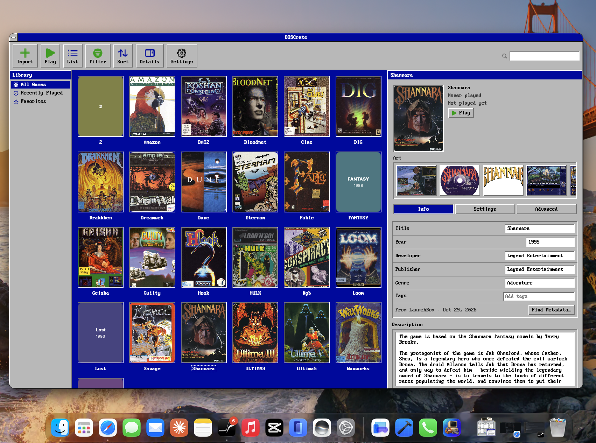

# DOSCrate for Mac

**DOSCrate** is a native macOS library manager and launcher for MS-DOS games, built with Swift 6 and SwiftUI for Apple Silicon Macs. It pairs a Finder-friendly `.doscrate` bundle format with a bundled [DOSBox Staging](https://www.dosbox-staging.org/) runtime so you can import, organize, configure, and play classic DOS games without writing config files by hand.



## Download

- **[Download DOSCrate 1.0.0 (`DOSCrate-1.0.0.dmg`)](https://github.com/songer522/DOSCrateForMac/releases/download/v1.0.0/DOSCrate-1.0.0.dmg)** *(macOS 15.0+, Apple Silicon — Developer ID signed & notarized)*
- Browse all releases on the **[GitHub Releases](https://github.com/songer522/DOSCrateForMac/releases)** page.

---

## Features

- **Flexible Game Import**
  - Import game folders, `.zip` archives, CD-ROM images (`.iso`, `.cue`/`.bin`), or floppy images (`.img`, `.ima`) via drag-and-drop or **File → Import…**.
  - Choose per-import or in Settings whether to **Copy into library** (self-contained `.doscrate` bundles) or **Keep in place** (referenced folders with security-scoped bookmarks).
  - Batch import multiple archives/folders at once, or toggle **Import each subfolder as a separate game** when pointing at a parent collection directory.
  - Automatic duplicate detection with **Skip**, **Replace** (preserving play stats, notes, custom cover art, and DOSBox settings), or **Keep Both**.

- **Automatic Metadata & Artwork**
  - Automatically matches imported games against the [LaunchBox Games Database](https://gamesdb.launchbox-app.com/) and downloads front box art and up to 6 screenshots.
  - Interactive **Find Metadata…** sheet with search by title, publisher, developer, or release year.
  - Drag-and-drop or pick custom cover images and screenshots directly in the inspector, with quick-look lightbox preview.

- **Two Complete Visual Themes**
  - **DOS Theme (Default)**: Classic 16-color VGA palette (`#0000AA` desktop, `#C0C0C0` raised/sunken beveled panels), VileR's `PxPlus IBM VGA 8x16` bitmap font, crisp pixel-art symbols, and retro modal dialogs and sheets.
  - **Standard Theme**: Native macOS split view, toolbar, and controls.

- **Hardware Presets & Per-Game Configuration**
  - Era presets from **IBM PC XT (1981)** through **Pentium (1995)** (`286`, `386`, `486`, `Pentium`), plus **Auto**.
  - Per-game overrides across five inspector tabs:
    - **Info**: Title, release year, developer, publisher, genre, notes, cover art, and screenshots.
    - **Program**: Main executable (`C:` relative path), optional setup/sound utility (`SETUP.EXE` / `INSTALL.EXE`), command-line arguments, and custom `C:` root subdirectory.
    - **Hardware**: Machine preset, CPU cycles (`Auto`, `Max`, or fixed cycles/s), memory (`4`–`64 MB`), aspect ratio correction, display filter/CRT shader, and fullscreen/windowed startup.
    - **Audio & Input**: Sound Blaster model, Gravis Ultrasound, MIDI device (`None`, `General MIDI` SoundFont `.sf2`, or `MT-32` ROM directory), mouse capture, and gamepad toggle.
    - **Discs**: Attach, reorder, or remove CD-ROM (`.iso`/`.cue`, mounted as `D:`) and floppy (`.img`/`.ima`, mounted as `A:`) images, plus custom `[autoexec]` commands.

- **Library Organization & Diagnostics**
  - Browse in **Grid** or **List** view with sorting by Title, Year, Last Played, or Play Time.
  - Smart sidebar collections: **All Games**, **Recent**, **Favorites**, and **Needs Attention** (missing executable, moved referenced folder, or corrupted metadata, with one-click repair actions).
  - Multi-facet **Filter** menu for **Genre**, **Year**, **Publisher**, and **Developer**.
  - Per-game `dosbox.log` viewer and automatic session play-time tracking.

---

## System Requirements

- **macOS 15.0 (Sequoia)** or later
- **Apple Silicon (`arm64`)** Mac

---

## Building from Source

### Prerequisites

- **Xcode 16.0+** (Swift 6.0 toolchain)
- **[XcodeGen](https://github.com/yonaskolb/XcodeGen)** (`brew install xcodegen`)
- `curl`, `hdiutil`, and `shasum` (included with macOS) to fetch and verify the pinned DOSBox Staging runtime

### Quick Start

```bash
# 1. Download and verify the pinned DOSBox Staging universal dmg into Vendor/
make vendor

# 2. Generate DOSCrate.xcodeproj from project.yml
make generate

# 3. Build the Debug app
make build

# 4. Run Swift package tests + app unit tests (enforces zero compiler warnings)
make test
```

You can also open `DOSCrate.xcodeproj` directly in Xcode after running `make vendor && make generate`.

---

## Repository Layout

```text
├── App/                        # macOS app target (SwiftUI views, models, themes, resources)
│   ├── Models/                 # AppModel, Preferences, GamepadMonitor, MetadataCoordinator
│   ├── Theme/                  # RetroPalette, RetroFont, PixelSymbol, ThemedControls
│   └── Views/                  # Library, Inspector, Import/Metadata sheets, Retro views
├── AppTests/                   # Unit & UI hosting tests for the macOS app target
├── Packages/
│   └── DOSCrateKit/            # Core Swift package (Swift 6 strict concurrency)
│       ├── Sources/
│       │   ├── LibraryKit/     # .doscrate bundle I/O, Game model, LibraryStore, FSEvents watcher
│       │   ├── ConfigKit/      # Hardware presets & deterministic DOSBox Staging .conf generator
│       │   ├── ImportKit/      # Folder/ZIP/disc importer, executable ranker, duplicate detector
│       │   ├── LauncherKit/    # Child-process runner and session lifecycle management
│       │   └── MetadataKit/    # LaunchBox XML indexer, fuzzy title/query matcher, art downloader
│       └── Tests/              # Unit tests for all DOSCrateKit modules
├── scripts/
│   ├── staging.lock            # Pinned DOSBox Staging version and SHA-256 checksums
│   ├── fetch-staging.sh        # Downloads and verifies DOSBox Staging into Vendor/
│   ├── embed-staging.sh        # Embeds DOSBox Staging and license texts into the app bundle
│   ├── make-app-icon.swift     # Generates the AppIcon asset catalog images at build time
│   └── release.sh              # Archive, Developer ID sign, notarize, DMG, appcast & GPL source packager
├── Makefile                    # Common build, test, and release targets
└── project.yml                 # XcodeGen project specification
```

---

## Creating a Release

Releases are built, signed, notarized, and packaged via [`scripts/release.sh`](scripts/release.sh):

```bash
DEVELOPER_ID="Developer ID Application: Your Name (TEAMID)" \
NOTARY_PROFILE="your-notarytool-keychain-profile" \
DOSCRATE_APPCAST_URL="https://github.com/songer522/DOSCrateForMac/releases/latest/download/appcast.xml" \
DOSCRATE_SPARKLE_KEY="your-sparkle-ed25519-public-key" \
VERSION="1.0.0" \
make release
```

This produces in `build/release/`:
- `DOSCrate-<VERSION>.dmg` (Developer ID signed, notarized, and stapled)
- `appcast.xml` (Sparkle EdDSA-signed update feed)
- `dosbox-staging-<STAGING_VERSION>-source.tar.gz`, `glib-<version>.tar.xz`, and `gettext-<version>.tar.gz` (verified against [`scripts/staging.lock`](scripts/staging.lock) for GPL/LGPL compliance)

---

## License & Acknowledgements

- **DOSCrate** is licensed under the [MIT License](LICENSE) (`Copyright (c) 2026 Yang Song`).
- **DOSBox Staging**: DOSCrate bundles an unmodified copy of [DOSBox Staging 0.83.0](https://github.com/dosbox-staging/dosbox-staging/tree/v0.83.0), licensed under **GPL-2.0-or-later**, which uses the **LGPL-2.1-or-later** libraries `GLib` and `gettext` (`libintl`). DOSCrate executes DOSBox Staging as a separate child process via command-line arguments and configuration files. Complete corresponding source archives for DOSBox Staging, `GLib`, and `gettext` are attached to every DOSCrate release.
- **Font**: The DOS theme uses the `PxPlus IBM VGA 8x16` font from [The Ultimate Oldschool PC Font Pack](https://int10h.org/oldschool-pc-fonts/) by VileR, licensed under [CC BY-SA 4.0](https://creativecommons.org/licenses/by-sa/4.0/).
- **Metadata & Artwork**: Game information and images are provided by the [LaunchBox Games Database](https://gamesdb.launchbox-app.com/).
- **Updates**: In-app updates are powered by [Sparkle](https://sparkle-project.org/).
